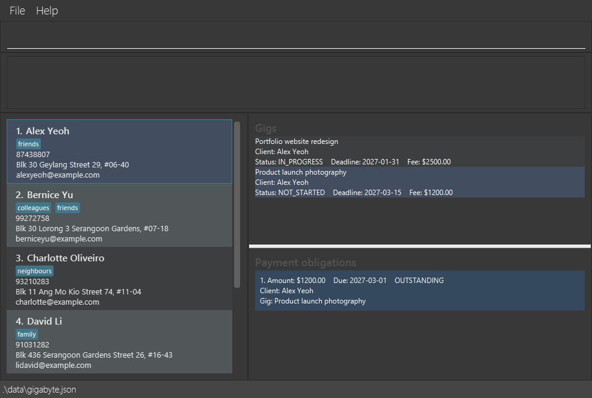
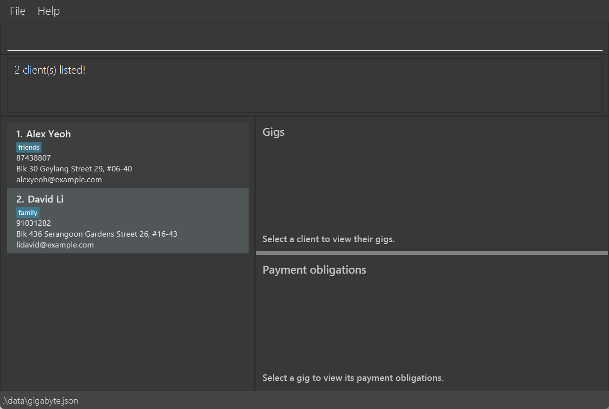

# Gigabyte User Guide

**Gigabyte** is a desktop application for freelancers who manage multiple clients, projects, and payment deadlines. It is optimized for use through a Command Line Interface (CLI) while retaining the benefits of a Graphical User Interface (GUI).

<!-- * Table of Contents -->
<page-nav-print />

--------------------------------------------------------------------------------------------------------------------

## Quick start

1. Ensure that Java `25` or later is installed on your computer.<br>
   **Mac users:** Ensure you have the precise JDK version prescribed [here](https://se-education.org/guides/tutorials/javaInstallationMac.html).

1. Download the latest `.jar` file from [here](https://github.com/AY2627S1-CS2103T-W14-4/tp/releases).

1. Copy the file to the folder you want to use as the _home folder_ for Gigabyte.

1. Open a terminal, `cd` to the folder containing the JAR file, and run `java -jar gigabyte.jar`.<br>
   A GUI similar to the one below should appear in a few seconds. Note how the app contains some sample data.<br>
   

1. Type a command in the command box and press Enter to execute it. For example, type **`help`** and press Enter to open the help window.<br>
   Some example commands you can try:

   * `list` : Lists all clients.

   * `add n/John Doe p/98765432 e/johnd@example.com a/John street, block 123, #01-01` : Adds a client named `John Doe` to the client list.

   * `delete 3` : Permanently deletes the 3rd client shown in the current list, if it has no gigs.

   * `addgig 1 t/Website redesign s/IN_PROGRESS d/2027-01-31 f/1250.00` : Adds a titled gig for the first displayed client.

   * `setstatus 1 2 s/COMPLETED` : Marks the second gig for the first displayed client as completed.

   * `addpayment 1 1 a/500.00 d/2027-02-15` : Records an unpaid obligation for that client's first gig.

   * `editpayment 1 1 2 a/650.00` : Changes the newly added payment's amount to `$650.00`.

   * `markpaid 1 1 2` : Marks that newly added payment as paid.

   * `markunpaid 1 1 2` : Corrects its status back to unpaid.

   * `clear` : Permanently deletes all clients, gigs, and payments.

   * `exit` : Exits the app.

1. Refer to the [Features](#features) section below for details of each command.

--------------------------------------------------------------------------------------------------------------------

## Features

<box type="info" seamless>

**Notes about the command format:**<br>

* Command words are not case-sensitive, but parameters keep the case you type.<br>
  For example, `LIST`, `List` and `list` all list clients, and `ADDGIG 1 t/Website Redesign ...` saves the title as `Website Redesign`.

* Words in `UPPER_CASE` are the parameters to be supplied by the user.<br>
  For example, in `add n/NAME`, replace `NAME` with a value such as `John Doe`.

* Items in square brackets are optional.<br>
  For example, `n/NAME [t/TAG]` can be used as `n/John Doe t/friend` or as `n/John Doe`.

* Items followed by `...` can appear zero or more times.<br>
  For example, `[t/TAG]... ` may be omitted, or written as `t/friend` or `t/friend t/family`.

* Parameters can be in any order.<br>
  For example, if the command specifies `n/NAME p/PHONE_NUMBER`, `p/PHONE_NUMBER n/NAME` is also acceptable.

* Money amounts are displayed with a dollar sign, comma thousands separators, and two decimal places,
  for example, `$1,234.50`. Enter amounts without dollar signs or commas, such as `a/1234.50` or `f/1234.50`.

* Extraneous parameters for `summary`, `help`, `list`, `exit`, and `clear` are ignored.<br>
  For example, `help 123` is interpreted as `help`.<br>
  `deadlines` and `outstanding` also take no parameters, but reject any extra input with an invalid command format message.

* If you are using a PDF version of this document, be careful when copying and pasting commands that span multiple lines as space characters surrounding line-breaks may be omitted when copied over to the application.
</box>

### Viewing help: `help`

Shows a message explaining how to access the help page.


Format: `help`


### Adding a client: `add`

Adds a client to the client list.

Format: `add n/NAME p/PHONE_NUMBER e/EMAIL a/ADDRESS [t/TAG]... `

* `PHONE_NUMBER` must have at least 3 digits and may start with a `+`. Digits may be grouped with single spaces
  or hyphens, e.g. `+65 9123 4567`, `6123-4567` or `+1-202-555-0143`. Letters, brackets and other symbols are not
  allowed, and the number cannot start or end with a space or hyphen, or contain two in a row.
* The phone number is saved and shown exactly as you type it.
* Each `TAG` must contain only letters and digits (no spaces or symbols) and be at most 25 characters long.
* The client is rejected if its name matches an existing client's name after ignoring case, leading and trailing
  spaces, and repeated spaces between words. For example, if `John Doe` exists, `john doe`, `JOHN DOE` and
  `John  Doe` are all rejected.
* Names that differ in any other way count as different clients, even if they look alike. For example, `Jon Doe`,
  `JohnDoe` and `John A Doe` are all accepted alongside `John Doe`. Typos and nicknames are not detected.
* If another client already has the same phone number, or the same email (ignoring case), the client is still added,
  and the result names that client, e.g. `Note: Bernice Yu has the same phone number.` This lets you record people who
  share a phone number or email, while still spotting accidental duplicates.

<box type="tip" seamless>

**Tip:** A client can have any number of tags, including zero.
</box>

Examples:
* `add n/John Doe p/98765432 e/johnd@example.com a/John street, block 123, #01-01`
* `add n/Betsy Crowe t/friend e/betsycrowe@example.com a/Newgate Prison p/1234567 t/criminal`
* `add n/Carl Kurz p/+65 9123 4567 e/carlk@example.com a/12 Orchard Road`

### Listing all clients: `list`

Shows a list of all clients in the client list.

Format: `list`

### Understanding indexes and filtered results

Gigabyte uses one-based indexes: the first displayed item is `1`, the second is `2`, and so on. Zero, negative
numbers, decimals, text, and indexes larger than the displayed list are invalid.

* A **client index** always refers to the numbered client in the list currently shown on the left. Every command
  that takes `CLIENT_INDEX` or `INDEX` uses this displayed list.
* `find` replaces the displayed client list with its matching results. A later command therefore uses the numbers in
  those results, not the numbers from the earlier full list. Run `list` to restore the full client list.
* A **gig index** is the gig's position in the chosen client's normal gig list, in recorded order. It never refers to
  a row in `gigs`, `deadlines`, or `findgig` results. Select the client to inspect this order; selection is optional
  when entering a command.
* A **payment index** is the payment's position within that gig's payment list, sorted by due date and then recorded
  order. It never refers to a row in `outstanding`. Select the client and gig to inspect this order. A date edit can
  change subsequent payment indexes.
* Commands take indexes in the order client, gig, payment, stopping after the last index shown in their format.

Example: after `find Bernice`, `addgig 1 ...` targets Bernice. After `list`, Bernice is client 2 in the sample data.

When an index is wrong, the error message tells you what kind of mistake it is:

* An index that is zero, negative, a decimal, or text, such as `delete 0` or `markpaid 1 -1 1`, shows
  `Index must be a positive integer.`
* A missing or extra index, or extra words before the first prefix, such as `markpaid 1 1`, `markpaid 1 1 1 2`, or
  `editgig 1 2 extra t/Website`, shows `Invalid command format!` followed by the command's correct format.
* An index larger than the displayed list, such as `delete 99`, shows that the index is invalid, for example
  `The client index provided is invalid.`

### Viewing gigs and payment obligations

Select a client in the client list to show only that client's gigs in the **Gigs** panel. Select a gig to show only
its payment obligations in the **Payment obligations** panel beneath the gig list. Payment obligations are numbered
from 1 and ordered by due date, earliest first. Obligations with the same due date retain the order in which they were
recorded. These displayed payment indexes restart from 1 for each selected gig; `editpayment`, `markpaid`, `deletepayment` and
`markunpaid` use them. `editpayment` resolves the selected payment before applying a due-date change that might move
the payment to a new displayed position.

When a list has keyboard focus, use **Up** and **Down** to select entries. **Right** moves focus from clients to gigs
or from gigs to payment obligations; **Left** moves back one list. Press **Tab** from any list to focus the
command box; press **Tab** from the command box to focus Clients. When a list gains focus with no selected row,
its first row is selected automatically if it has one. Selecting an entry keeps focus in its list so you can continue
browsing.

Each payment row shows its amount, due date, and current display state:

* `PAID`: the obligation has been marked as paid.
* `OUTSTANDING`: the obligation is unpaid and is due today or later.
* `OVERDUE`: the obligation is unpaid and its due date is before the current local date.

Paid, outstanding, and overdue rows use distinct colors. `OVERDUE` is calculated for display only and does not change
the saved paid status. If there is no selection or no data for the selection, the panels explain whether to select a
client, select a gig, or that the selected gig has no payment obligations.

Payment status is maintained manually. Use `markpaid` after receiving payment, and use `markunpaid` to correct an
obligation that was marked paid by mistake.

### Viewing outstanding payments: `outstanding`

Format: `outstanding`

Lists **unpaid** obligations across all gigs and clients, including clients hidden by `find`. Rows show the client,
gig title, amount, due date, and payment state. Results sort by due date, earliest first; ties keep their recorded order.

* `OVERDUE` means an unpaid obligation is due **before today**, using your computer's local calendar date.
  Obligations due today or later display `OUTSTANDING`. Text and color identify overdue items, and the display
  refreshes at local midnight without changing records.
* Paid obligations are excluded. The empty state is `No outstanding payment obligations.`.
* Results wrap and scroll vertically. Selecting a client and gig restores that gig's payment view.
  Overview row numbers are not `editpayment`, `markpaid`, or `markunpaid` payment indexes; select the client and gig
  to check the per-gig indexes.
* While this overview is visible, `markpaid` removes the selected obligation immediately, `markunpaid` restores it
  immediately, and `editpayment` refreshes and reorders it immediately when applicable. Displaying results does not
  change records or the client list. The command takes no arguments; `outstanding extra` is rejected.

### Filtering gigs by status: `gigs`

Format: `gigs s/STATUS`

Shows matching gigs across **all clients**, even when `find` has narrowed the client list. Each row shows the title,
client name, status, deadline, and agreed fee. Results keep the order in which gigs were recorded and scroll vertically.

* `STATUS` is `NOT_STARTED`, `IN_PROGRESS`, or `COMPLETED`, ignoring case and surrounding whitespace.
* Supply exactly one `s/` argument. Missing, unsupported, repeated, or extra arguments are rejected.
* No matches displays `No gigs with status STATUS.`. Filtering does not modify stored records or the client list.
* Running `gigs` clears client/gig selections and the payment panel. Select a result to view its payments, or select
  a client to return to that client's gigs. Indexed commands still use the normal per-client gig order described in
  [Understanding indexes and filtered results](#understanding-indexes-and-filtered-results).

Examples: `gigs s/IN_PROGRESS`, `gigs s/completed`. Invalid examples: `gigs`, `gigs s/WAITING`,
`gigs s/IN_PROGRESS s/COMPLETED`.

### Viewing active deadlines: `deadlines`

Format: `deadlines`

Shows every gig whose status is not `COMPLETED`, across all clients, in the **Gigs** panel.
Rows contain the gig title, client name, status, deadline, and agreed fee. Results are ordered by
deadline ascending; equal deadlines are ordered deterministically by client name, gig title, and gig UID.

Deadlines before the current local date remain visible and are labelled `OVERDUE`. Completed gigs are
never included in this view. The command does not change the client filter. Selecting a client returns
the panel to that client's normal gig view, and running `deadlines` again restores the overview. The
overview updates automatically when gigs are added, changed, or removed.

If there are no active gigs, the panel displays `There are no active gig deadlines.`

`deadlines` takes no parameters. Extra input, such as `deadlines 1`, is rejected with an invalid command format
message, and the current view stays unchanged.

### Creating a gig: `addgig`

Creates a gig linked to an existing client and saves it automatically.

Format: `addgig INDEX t/TITLE s/STATUS d/DEADLINE f/FEE`

* `INDEX` is the positive index shown in the current client list, including filtered `find` results.
* All four fields are required and may appear in any order. Each prefix must appear exactly once.
* `TITLE` is a short description containing 1–100 characters after leading and trailing whitespace is removed.
  Internal spaces and common punctuation are allowed. Titles do not need to be unique.
* `STATUS` is `NOT_STARTED`, `IN_PROGRESS`, or `COMPLETED` (case-insensitive).
* `DEADLINE` is a valid calendar date in `yyyy-MM-dd` format.
* `FEE` is a positive amount with at most two decimal places, without a currency symbol.
* The confirmation shows the linked client, title, status, deadline, and agreed fee. The displayed client list stays
  unchanged, including when it is filtered.
* Gigs, including their titles, are retained after restarting the app. Every saved gig must have a valid title.

Successful examples:

* `addgig 1 t/Website redesign s/NOT_STARTED d/2027-01-31 f/1250.00`
* `find Bernice` followed by
  `addgig 1 t/Product photography s/in_progress d/2027-02-28 f/500.50`
  creates a titled gig for the first matching client.

Unsuccessful examples:

Command | Why it is rejected
--------|-------------------
`addgig 1 t/ s/NOT_STARTED d/2027-01-31 f/1250.00` | The title is blank after surrounding whitespace is removed.
`addgig 1 t/Website redesign s/WAITING d/2027-01-31 f/1250.00` | `WAITING` is not a supported status.
`addgig 1 t/Website redesign s/NOT_STARTED d/2027-02-29 f/1250.00` | 2027 is not a leap year, so the date is invalid.
`addgig 1 t/Website redesign s/NOT_STARTED d/2027-01-31 f/0` | Fees must be greater than zero.
`addgig 1 t/Website redesign t/Second title s/NOT_STARTED d/2027-01-31 f/1250.00` | The single-valued `t/` prefix is repeated.
`addgig 0 t/Website redesign s/NOT_STARTED d/2027-01-31 f/1250.00` | Client indexes start at 1.

### Editing a gig: `editgig`

Corrects a gig's title, deadline, agreed fee, or any combination of these fields and saves the result automatically.

Format: `editgig CLIENT_INDEX GIG_INDEX [t/TITLE] [d/DEADLINE] [f/FEE]`

* Both indexes follow [Understanding indexes and filtered results](#understanding-indexes-and-filtered-results),
  even while an overview is visible.
* Provide at least one field, in any order, with each prefix appearing once. Title, deadline, and fee follow the same
  validation rules as `addgig`; surrounding title whitespace is trimmed. Use `setstatus` for status changes:
  `s/STATUS` is rejected by `editgig`.
* The gig retains its UID, client, status, and all payment obligations, including their paid states and amounts.
  Correcting the agreed fee does not change recorded payment amounts.
* All fields are validated before any change. Missing fields, invalid indexes or values, repeated prefixes, and
  edits that would leave the gig unchanged are rejected without changing records.
* Client and status views refresh immediately. Changing a deadline reorders the deadline overview; changing a title
  can also change the order when deadlines are equal. Both indexes are resolved before the edit is applied.

Examples: `editgig 1 2 t/Updated landing page`, `editgig 1 2 d/2027-04-30 f/1800.00`.
After `find Bernice`, `editgig 1 1 t/Revised branding` edits the first matching client's first gig.

Rejected examples: `editgig 1 2` (no fields), `editgig 1 2 d/2027-02-29` (invalid date),
`editgig 1 2 t/First t/Second` (repeated `t/`), and `editgig 1 99 f/100` (gig index out of range).
`editgig 1 2 f/1200.00` is a no-op on fresh sample data and is also rejected.

### Deleting a gig: `deletegig`

Format: `deletegig CLIENT_INDEX GIG_INDEX`

**This command is destructive:** it permanently deletes one gig in any status, provided it has no payment
obligations. Deletion is immediate, saved automatically, and cannot be undone. The client, other gigs, and their
payments remain unchanged.

* Supply exactly two positive integer indexes as defined in
  [Understanding indexes and filtered results](#understanding-indexes-and-filtered-results).
* Any paid or unpaid obligation blocks deletion. The error instructs you to delete those obligations first using
  `deletepayment`; marking them paid does not allow gig deletion.
  For a gig with one payment, run `deletepayment 1 1 1` followed by `deletegig 1 1` to remove both permanently.
* Identical-looking gigs are separate records: only the indexed gig is removed. Remaining gigs are renumbered.
* Open gig views refresh immediately. Deleting the selected gig clears its selection and payment view.
* Invalid syntax, out-of-range indexes, and payment dependencies leave records and the saved file unchanged.
* Once a client's final gig is deleted, the client can be removed using `delete CLIENT_INDEX`.

Example with fresh sample data: `deletegig 2 2` removes Bernice's Quarterly newsletter template, which has no payments.
After `find Bernice`, the equivalent command is `deletegig 1 2`.
Rejected examples: `deletegig 1 1` (its payment blocks deletion), `deletegig 0 1` (invalid index), and
`deletegig 1 99` (gig index out of range).

### Updating a gig's status: `setstatus`

Changes the status of one existing gig and saves it automatically. The gig keeps its title, client, deadline, agreed
fee, and UID. Existing payment obligations remain linked to it, and the **Gigs** panel refreshes as soon as the
command succeeds.

Format: `setstatus CLIENT_INDEX GIG_INDEX s/STATUS`

* Both indexes follow [Understanding indexes and filtered results](#understanding-indexes-and-filtered-results).
* `STATUS` is `NOT_STARTED`, `IN_PROGRESS`, or `COMPLETED`; parsing ignores case and surrounding whitespace.
* Supply exactly two indexes and one `s/` field. Missing or unsupported statuses, repeated `s/` fields, extra
  positional arguments, and indexes outside the displayed lists are rejected without changing stored data.
* Requesting the gig's current status is rejected. Statuses can otherwise be changed in either direction.

Examples:

* `setstatus 1 2 s/IN_PROGRESS`
* `setstatus 1 2 s/completed`
* `find Bernice` followed by `setstatus 1 1 s/IN_PROGRESS` updates the first gig belonging to the first matching client.

Unsuccessful examples:

Command | Why it is rejected
--------|-------------------
`setstatus 1 2` | A status is required.
`setstatus 1 2 s/WAITING` | `WAITING` is not a supported status.
`setstatus 1 2 s/IN_PROGRESS s/COMPLETED` | The single-valued `s/` prefix is repeated.
`setstatus 1 2 3 s/COMPLETED` | Exactly two indexes are required.
`setstatus 1 99 s/COMPLETED` | The selected client does not have a gig at position 99.
`setstatus 1 2 s/NOT_STARTED` | Gig 2 is already `NOT_STARTED`.

### Recording a payment obligation: `addpayment`

Records an unpaid payment obligation against an existing gig and saves it automatically.

Format: `addpayment CLIENT_INDEX GIG_INDEX a/AMOUNT d/DUE_DATE`

* Both indexes follow [Understanding indexes and filtered results](#understanding-indexes-and-filtered-results).
* Both indexes and both fields are required. The `a/` and `d/` fields may appear in either order, once each.
* `AMOUNT` must be positive with at most two decimal places, without a currency symbol.
* `DUE_DATE` must be a valid calendar date in `yyyy-MM-dd` format.
* Multiple obligations may be recorded for the same gig. New obligations start unpaid.
* Invalid input leaves existing clients, gigs, and obligations unchanged.
* Obligations survive restarting the app. The save file must include a `paymentObligations` array, even when empty.

Successful examples:

* `addpayment 1 2 a/500.00 d/2027-01-31` records an obligation for the second gig of the first displayed client.
* `find Alex` followed by `addpayment 1 1 d/2027-02-15 a/250` records an obligation for the first gig belonging to
  the first matching client. The prefixed fields may appear in either order.

Unsuccessful examples:

Command | Why it is rejected
--------|-------------------
`addpayment 0 1 a/500.00 d/2027-01-31` | Client indexes start at 1.
`addpayment 1 0 a/500.00 d/2027-01-31` | Gig indexes start at 1.
`addpayment 1 99 a/500.00 d/2027-01-31` | The selected client does not have a gig at position 99.
`addpayment 1 1 a/-10 d/2027-01-31` | Amounts must be positive numbers.
`addpayment 1 1 a/500.00 d/31-01-2027` | Dates must use `yyyy-MM-dd`.
`addpayment 1 1 a/500.00 a/600.00 d/2027-01-31` | The single-valued `a/` prefix is repeated.

The confirmation names the client and gig position, amount, and due date. To see the saved obligation, select the
client and gig in the application; the **Payment obligations** panel refreshes immediately.

### Editing a payment obligation: `editpayment`

Corrects the amount, due date, or both fields of an existing payment obligation and saves the change automatically.

Format: `editpayment CLIENT_INDEX GIG_INDEX PAYMENT_INDEX [a/AMOUNT] [d/DUE_DATE]`

* All three indexes follow [Understanding indexes and filtered results](#understanding-indexes-and-filtered-results).
* At least one of `a/AMOUNT` or `d/DUE_DATE` is required. Each may appear at most once and in either order.
* `AMOUNT` and `DUE_DATE` follow the same validation rules as `addpayment`.
* Gigabyte resolves all three indexes before changing anything. If a due-date edit changes the payment's displayed
  position, the edit still applies to the payment that occupied `PAYMENT_INDEX` when the command began.
* The payment remains attached to the same gig and keeps its paid or unpaid state. Paid payments can be corrected.
* A command that would leave both details unchanged is rejected. Invalid input leaves all payment data unchanged.
* The selected gig's payment panel refreshes and reorders immediately. If the outstanding overview is visible, it
  refreshes immediately too, including overdue styling derived from the new due date.

Successful examples:

* `editpayment 1 2 1 a/650.00` changes only the amount of payment 1.
* `editpayment 1 2 1 d/2027-05-15` changes only its due date and may move the row.
* `editpayment 1 2 1 a/650.00 d/2027-05-15` changes both details atomically.

Unsuccessful examples:

Command | Why it is rejected
--------|-------------------
`editpayment 1 2 1` | At least one editable field is required.
`editpayment 1 2 a/650.00` | Exactly three indexes are required.
`editpayment 1 2 99 a/650.00` | The selected gig has no payment at position 99.
`editpayment 1 2 1 a/0` | Amounts must be positive numbers.
`editpayment 1 2 1 d/2027-02-29` | The due date must be a valid `yyyy-MM-dd` calendar date.
`editpayment 1 2 1 a/650 a/700` | The single-valued `a/` prefix is repeated.
`editpayment 1 2 1 a/650` when its amount is already `$650.00` | The resulting payment would be unchanged.

### Marking a payment as paid: `markpaid`

Marks one outstanding payment obligation as paid and saves it automatically.

Format: `markpaid CLIENT_INDEX GIG_INDEX PAYMENT_INDEX`

* All three indexes follow [Understanding indexes and filtered results](#understanding-indexes-and-filtered-results).
* All three indexes are required. Zero, negative, non-numeric, missing, extra, and out-of-range indexes are rejected.
* A payment that is already paid cannot be marked paid again. This leaves the saved data unchanged.
* The selected row changes to `PAID` immediately. Its gig, amount, and due date remain the same, and the paid state
  survives restarting Gigabyte.

Successful examples:

* `markpaid 1 2 1` marks Alex's unpaid sample payment as paid.
* `find Bernice` followed by `markpaid 1 1 1` marks Bernice's unpaid sample payment as paid.

Unsuccessful examples:

Command | Why it is rejected
--------|-------------------
`markpaid 0 1 1` | Client indexes start at 1.
`markpaid 1 0 1` | Gig indexes start at 1.
`markpaid 1 1 0` | Payment indexes start at 1.
`markpaid 1 1 99` | The selected gig has no payment at position 99.
`markpaid 1 1` | Exactly three indexes are required.
`markpaid 1 1 1 2` | Extra positional indexes are not accepted.
`markpaid 1 1 1` on an already paid row | A paid obligation cannot be marked paid a second time.

### Marking a payment as unpaid: `markunpaid`

Corrects a payment obligation that was marked paid by mistake and saves the unpaid state automatically.

Format: `markunpaid CLIENT_INDEX GIG_INDEX PAYMENT_INDEX`

* The client, gig, and payment indexes follow exactly the same rules as `markpaid`, including after `find`.
* All three indexes are required. Zero, negative, non-numeric, missing, extra, and out-of-range indexes are rejected.
* Only a paid obligation can be marked unpaid. Repeating `markunpaid` on an unpaid obligation is rejected without
  changing data.
* The obligation keeps its gig, amount, and due date. Its row refreshes immediately and the unpaid state survives
  restarting Gigabyte.
* The corrected obligation immediately reappears in the `outstanding` overview. A due date before the current local
  date displays `OVERDUE`; a due date today or later displays `OUTSTANDING`.

Successful examples:

* `markunpaid 1 1 1` corrects Alex's paid sample payment to unpaid.
* `find Alex` followed by `markunpaid 1 1 1` corrects the same payment while the client list is filtered.

Unsuccessful examples:

Command | Why it is rejected
--------|-------------------
`markunpaid 0 1 1` | Client indexes start at 1.
`markunpaid 1 0 1` | Gig indexes start at 1.
`markunpaid 1 1 0` | Payment indexes start at 1.
`markunpaid 1 1 99` | The selected gig has no payment at position 99.
`markunpaid 1 1` | Exactly three indexes are required.
`markunpaid 1 1 1 2` | Extra positional indexes are not accepted.
`markunpaid 1 1 1` on an unpaid row | An unpaid obligation cannot be marked unpaid again.

### Deleting a payment obligation: `deletepayment`

Permanently removes one incorrectly recorded, duplicate, or cancelled payment obligation and saves the deletion
automatically. Both paid and unpaid obligations, including overdue obligations, can be deleted.

Format: `deletepayment CLIENT_INDEX GIG_INDEX PAYMENT_INDEX`

**This command is destructive: it deletes immediately without a confirmation prompt and cannot be undone.** Check
the displayed indexes before running it. The deleted obligation will not return after restarting Gigabyte.

* Uses the same three indexes as `markpaid`: the client in the currently displayed list (including `find` results),
  the gig within that client's gig list, and the payment within that gig's payment list.
* Payment indexes use earliest due date first; ties keep their recorded order. They are not the row numbers in the
  `outstanding` overview. Selecting the client and gig lets you check the indexes; selection is not required to run
  the command.
* Deletes exactly the indexed obligation, even if another obligation has identical fields. The client, parent gig,
  and all other obligations remain unchanged. Remaining payments keep their relative order and are renumbered.
* The selected payment list refreshes immediately. Deleting an unpaid obligation also removes it immediately from
  an open `outstanding` overview.
* Removing a gig's final obligation displays `This gig has no payment obligations.` when that gig is selected.
  If no unpaid obligations remain, the outstanding overview displays `No outstanding payment obligations.`.
* Success feedback includes the client, gig index and title, payment index, amount, due date, and previous state
  (`PAID` or `UNPAID`). Overdue obligations have previous state `UNPAID`.
* Exactly three positive integer indexes are required. Invalid or out-of-range indexes leave records and the saved
  file unchanged.

Examples:

* `deletepayment 1 2 1` deletes Alex's second gig's sample payment.
* `find Bernice` followed by `deletepayment 1 1 1` deletes Bernice's first gig's sample payment.

Example success message:

```text
Deleted payment obligation for Alex Yeoh, gig 1 (Portfolio website redesign), payment 1: Amount: $1,250.00; Due date: 2027-01-15; Previous state: PAID
```

Unsuccessful examples:

Command | Why it is rejected
--------|-------------------
`deletepayment 0 1 1` | Client indexes start at 1.
`deletepayment 1 -1 1` | Gig indexes must be positive integers.
`deletepayment 1 1 abc` | Payment indexes must be positive integers.
`deletepayment 99 1 1` | Rejected if there is no displayed client at position 99.
`deletepayment 1 99 1` | Rejected if the chosen client has no gig at position 99.
`deletepayment 1 1 99` | Rejected if the chosen gig has no payment at position 99.
`deletepayment 1 1` | Exactly three indexes are required.
`deletepayment 1 1 1 2` | Extra positional indexes are not accepted.

### Editing a client: `edit`

Edits an existing client in the client list.

Format: `edit INDEX [n/NAME] [p/PHONE] [e/EMAIL] [a/ADDRESS] [t/TAG]... `

* Edits the client at the specified `INDEX`. The index refers to the index number shown in the displayed client list. The index **must be a positive integer** 1, 2, 3, ...
* At least one of the optional fields must be provided.
* Existing values will be updated to the input values.
* A new phone number follows the same rules as in [`add`](#adding-a-client-add).
* When editing tags, all of the client's existing tags are removed; adding tags is not cumulative.
  Each tag follows the same rules as in [`add`](#adding-a-client-add).
* To remove all of a client's tags, enter `t/` without a tag after it.
* A new name is checked against every other client using the same rule as in [`add`](#adding-a-client-add).
  Changing only the capitalisation or spacing of a client's own name (e.g. `John Doe` to `JOHN DOE`) is allowed,
  unless another client already has exactly the new name.
* If the edited client then has the same phone number or email as another client, the edit is still saved, and the
  result shows the same note as `add`. A client is never compared with itself.

Examples:
* `edit 1 p/91234567 e/alexnew@example.com` changes Alex's phone and email in fresh sample data.
* `edit 2 n/Bernice Chen t/` changes Bernice's name and clears her existing tags.

### Locating clients by name: `find`

Finds clients whose names contain any of the given keywords.

Format: `find KEYWORD [MORE_KEYWORDS]`

* The search is case-insensitive; for example, `hans` matches `Hans`.
* Keyword order does not matter; for example, `Hans Bo` matches `Bo Hans`.
* The search considers only names.
* Only full words match; for example, `Han` does not match `Hans`.
* Clients matching at least one keyword are returned (an `OR` search); for example, `Hans Bo` returns `Hans Gruber` and `Bo Yang`.

Examples:
* `find Alex` returns `Alex Yeoh` in fresh sample data.
* `find alex david` returns `Alex Yeoh`, `David Li`<br>
  

### Deleting a client: `delete`

**Destructive:** permanently deletes the specified client from the client list without a confirmation prompt or undo.

Format: `delete INDEX`

* Deletes the client at the specified `INDEX`.
* A client with associated gigs cannot be deleted. Remove its gigs using `deletegig` first.
* The index refers to the index number shown in the displayed client list.
* The index **must be a positive integer** 1, 2, 3, ...

Examples:
* `list` followed by `delete 3` deletes the 3rd sample client, who has no associated gigs.
* `find David` followed by `delete 1` deletes the 1st client in the results of the `find` command.

### Locating gigs by title: `findgig`

Finds gigs whose titles contain any of the supplied keywords.

Format: `findgig KEYWORD [MORE_KEYWORDS]`

* The search is case-insensitive and considers gig titles only.
* Each keyword must match a complete word; for example, `site` does not match `website`.
* Multiple keywords use OR semantics: a gig is shown when its title contains at least one keyword.
* Duplicate keywords do not duplicate results.
* Results include gigs for all clients, even when the client list is filtered, and retain the original gig order.
* Selecting a result displays that gig's payment obligations. Selecting a client returns to that client's normal gig list.
* An empty query is rejected. If there are no matches, the panel displays `No gigs match the supplied title keywords.`

Examples:
* `findgig website` finds titles containing the complete word `website`.
* `findgig website redesign` finds titles containing either `website` or `redesign`.
* `findgig nonexistenttitle` displays the empty result; `findgig` without a keyword is rejected.

### Viewing a work and payment summary: `summary`

Shows counts for all stored clients and gigs, followed by payment totals. The command ignores the current client
filter and does not change any selection, filter, or stored data.

Format: `summary`

Example: `summary` on fresh sample data reports six clients, four gigs, three payment obligations, and one marked
paid obligation. The overdue subset depends on the current local date.

The payment section reports unpaid obligations as **Outstanding**, with **Of which overdue** explicitly identifying
the subset whose due date is before today. Obligations due today are not overdue. **Marked paid** is the total of
obligations recorded as paid; it is not revenue because Gigabyte does not record when money was received. All totals
are calculated exactly to cents.

### Clearing all entries: `clear`

**Destructive:** permanently clears all clients, their gigs, and payment obligations without a confirmation prompt
or undo. Back up `data/gigabyte.json` first if you need to keep those records.

Format: `clear`

Example: `clear` removes all six sample clients and their linked gigs and payments. Repeating `clear` succeeds with
an already empty data set and leaves it empty.

### Exiting the program: `exit`

Exits the program.

Format: `exit`

### Saving the data

Gigabyte saves the complete data set after every successfully executed command, including read-only commands such as
`list`. Invalid commands do not trigger a save. You do not need to save manually.
Client, gig, and payment-obligation data is restored when you next launch the app from the same home folder.

When upgrading from a version that saved to `data/addressbook.json`, Gigabyte automatically renames that file to
`data/gigabyte.json` on startup if `data/gigabyte.json` does not already exist. Its contents are preserved, and future
changes are saved to `data/gigabyte.json`. If both files exist, Gigabyte uses `data/gigabyte.json` and leaves
`data/addressbook.json` untouched. If the rename fails, startup stops and the error is reported in the console.

### Editing the data file

Gigabyte data is saved automatically as a JSON file `[JAR file location]/data/gigabyte.json`. Advanced users are welcome to update data directly by editing that data file.

Client records are stored in the `clients` array with stable `uid` values. Gigs refer to clients by `clientUid`, store
their titles as plain text, and are referenced by payment obligations using `gigUid`. Fees and payment amounts are
stored as positive integer cents. The `clients`, `gigs`, and `paymentObligations` arrays are all required; use `[]`
for an empty collection. Each client must include its `uid`, contact fields, and `tags` array. Each gig must include
its `uid`, `clientUid`, `title`, `status`, `deadline`, and `feeCents`. Each payment obligation must include its
`gigUid`, `amountCents`, `dueDate`, and `paid` state.

Two clients in the data file must not have exactly the same name. Data files from earlier versions may contain clients
whose names differ only in case or spacing, such as `John Doe` and `john doe`. These files still load, and both
clients can be edited as usual. Gigabyte only stops you from creating new pairs like this with `add` or `edit`.

Only the current JSON format is supported. In particular, v1.3 files using `persons`, missing UUIDs or titles,
client-name links, decimal `fee`/`amount` strings, or `gigIndex` references cannot be loaded. Unknown fields and
missing required fields are rejected. The automatic filename move does not convert JSON formats. Before upgrading,
keep a copy of the v1.3 file and convert it to the current schema if you need to retain its records.

<box type="warning" seamless>

**Caution:**
If the data file is invalid or uses an unsupported older format, Gigabyte starts with an empty client list at the next run. The original file remains on disk until the next successful command overwrites it, even if that command is `list`. Back up the file before editing it or trying an upgrade.<br>
Furthermore, certain edits can cause Gigabyte to behave in unexpected ways (e.g., if a value entered is outside of the acceptable range). Therefore, edit the data file only if you are confident that you can update it correctly.
</box>

## FAQ

**Q**: How do I transfer my data to another computer?<br>
**A**: Install the app on the other computer and copy a current-format `data/gigabyte.json` into the same relative
location in the new home folder before launching the JAR. Keep a backup of both copies. Older JSON formats are not
supported.

--------------------------------------------------------------------------------------------------------------------

## Known issues

1. **If you minimize the Help Window** and then run the `help` command (or use the `Help` menu, or the keyboard shortcut `F1`) again, the original Help Window will remain minimized, and no new Help Window will appear. The remedy is to manually restore the minimized Help Window.
1. **v1.3 JSON is not migrated.** The old filename is moved, but its older record shape is rejected. Keep the old
   file and convert it before issuing a command in v1.4.
1. **Saving is not atomic.** A failed disk write can leave the destination file incomplete. Keep an external backup
   before large or destructive changes.

--------------------------------------------------------------------------------------------------------------------

## Command summary

Action     | Format, Examples
-----------|----------------------------------------------------------------------------------------------------------------------------------------------------------------------
**Add**    | `add n/NAME p/PHONE_NUMBER e/EMAIL a/ADDRESS [t/TAG]... ` <br> e.g., `add n/James Ho p/22224444 e/jamesho@example.com a/123, Clementi Rd, 1234665 t/friend t/colleague`
**Add gig** | `addgig INDEX t/TITLE s/STATUS d/DEADLINE f/FEE` <br> e.g., `addgig 1 t/Website redesign s/NOT_STARTED d/2027-01-31 f/1250.00`
**Delete gig permanently** | `deletegig CLIENT_INDEX GIG_INDEX` <br> e.g., `deletegig 2 2`
**Add payment** | `addpayment CLIENT_INDEX GIG_INDEX a/AMOUNT d/DUE_DATE` <br> e.g., `addpayment 1 2 a/500.00 d/2027-01-31`
**Edit payment** | `editpayment CLIENT_INDEX GIG_INDEX PAYMENT_INDEX [a/AMOUNT] [d/DUE_DATE]` <br> e.g., `editpayment 1 2 1 a/650.00 d/2027-05-15`
**Mark payment paid** | `markpaid CLIENT_INDEX GIG_INDEX PAYMENT_INDEX` <br> e.g., `markpaid 1 2 1`
**Mark payment unpaid** | `markunpaid CLIENT_INDEX GIG_INDEX PAYMENT_INDEX` <br> e.g., `markunpaid 1 1 1`
**Delete payment permanently** | `deletepayment CLIENT_INDEX GIG_INDEX PAYMENT_INDEX` <br> e.g., `deletepayment 1 2 1`
**Set gig status** | `setstatus CLIENT_INDEX GIG_INDEX s/STATUS` <br> e.g., `setstatus 1 2 s/COMPLETED`
**Clear permanently**  | `clear`
**Delete client permanently** | `delete INDEX`<br> e.g., `delete 3`
**Edit**   | `edit INDEX [n/NAME] [p/PHONE_NUMBER] [e/EMAIL] [a/ADDRESS] [t/TAG]... `<br> e.g.,`edit 2 n/James Lee e/jameslee@example.com`
**Edit gig** | `editgig CLIENT_INDEX GIG_INDEX [t/TITLE] [d/DEADLINE] [f/FEE]`<br> e.g., `editgig 1 2 t/Updated landing page f/1800.00`
**Exit**   | `exit`
**Find**   | `find KEYWORD [MORE_KEYWORDS]`<br> e.g., `find James Jake`
**Find gigs** | `findgig KEYWORD [MORE_KEYWORDS]`<br> e.g., `findgig website redesign`
**Filter gigs** | `gigs s/STATUS`<br> e.g., `gigs s/IN_PROGRESS`
**Active deadlines** | `deadlines`
**Outstanding payments** | `outstanding`
**List**   | `list`
**Help**   | `help`
**Summary** | `summary`
